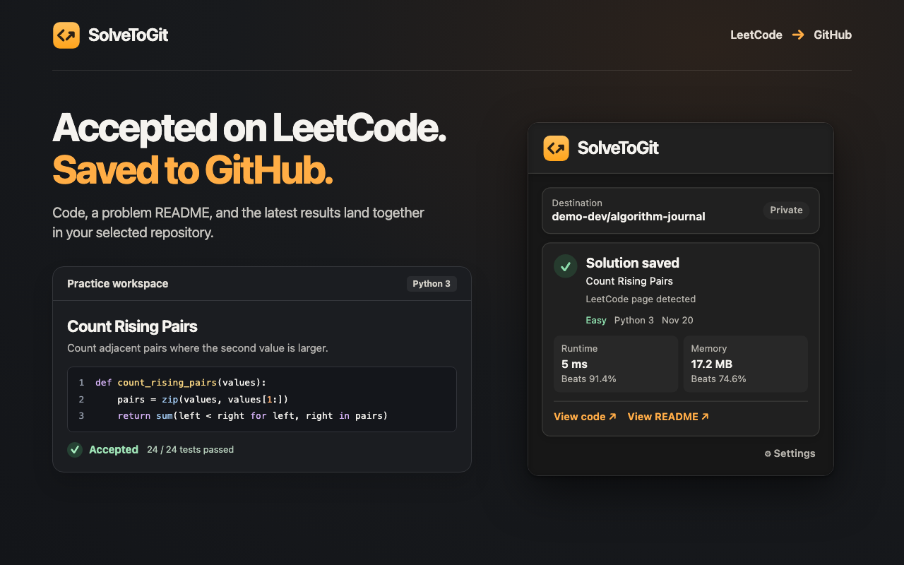

# SolveToGit

SolveToGit saves accepted LeetCode solutions to one GitHub repository you choose. Each sync commits your exact source and a problem README together, with the verdict, runtime, memory, and test results LeetCode provides.

[Download for Chrome](https://github.com/dvoyevoda/solvetogit/releases/latest) · [Privacy policy](PRIVACY.md) · [Help and feedback](#help-and-feedback)

## Install on Chrome

1. Download and extract the manual-install Chrome ZIP from the latest release.
2. Open `chrome://extensions`, turn on **Developer mode**, and click **Load unpacked**.
3. Select the extracted `extension` folder. Open SolveToGit from the Extensions menu and refresh any LeetCode tabs that were already open. [Chrome’s extension installation guide](https://developer.chrome.com/docs/extensions/get-started/tutorial/hello-world#load-unpacked)

Upgrading an unpacked copy? Copy the new files into the same `extension` folder Chrome already loads, then click **Reload** and refresh LeetCode. This also applies to copies labeled LeetGit or LeetRelay. Keep your `config.js` if you configured the self-hosted GitHub App companion.

## Connect one repository

Choose or create a GitHub repository for your solutions. Starting a new repository with a README creates its default branch. Use a private repository if you want your solutions to stay private.

1. Paste its GitHub URL or enter `owner/repository`, then click **Create GitHub token**. SolveToGit pre-fills the owner, a 365-day lifetime, a description naming your repository, and **Contents → Read and write**. Account and organization policies may limit the lifetime. [GitHub’s supported form fields](https://docs.github.com/en/authentication/keeping-your-account-and-data-secure/managing-your-personal-access-tokens#supported-query-parameters)
2. On GitHub, verify the resource owner. Under **Repository access**, choose **Only select repositories** and select your destination. Confirm **Contents → Read and write** before generating the token. [GitHub’s token setup guide](https://docs.github.com/en/authentication/keeping-your-account-and-data-secure/managing-your-personal-access-tokens#creating-a-fine-grained-personal-access-token)
3. Paste the new `github_pat_` token into SolveToGit and click **Connect repository**. Submit a solution on a signed-in `leetcode.com` practice page. An **Accepted** result triggers the sync and confirms GitHub write access once it succeeds.

The popup remembers the repository field when you close it. An unfinished token stays in Chrome’s extension memory until you finish setup or close Chrome. To replace an expired or revoked token, use **Settings → Reconnect**. The self-hosted edition also supports a GitHub App. [Companion deployment guide](worker/DEPLOY.md)

## What gets saved

- Each problem has its own folder. For example, Two Sum uses `solutions/1-two-sum/`, with `README.md` and a source file such as `python3.py`.
- The README contains the problem link, available difficulty and topics, a code preview, and the latest accepted results per language. Runtime, memory, percentiles, and test counts appear when LeetCode provides them.
- SolveToGit includes available full text for non-premium problems by default. Turn off **Include full problem text** in Settings to save a short overview and official link. Include full text where you have permission to share it. [LeetCode Terms of Service](https://leetcode.com/terms/)
- Existing slug-only folders move to the numbered path on the next sync when the number is available and the path is free. Keep your own notes outside the generated section to preserve them through updates.

The popup follows the active problem. After a successful sync, the toolbar shows a green check on that problem and the popup links to the code and README. The retry queue handles temporary sync failures. [Privacy policy](PRIVACY.md)

## Help and feedback

- **GitHub denies access or the token expired.** Use **Settings → Reconnect** with a fine-grained token scoped to the destination and **Contents → Read and write**. If your organization requires approval, check the token’s status on GitHub.
- **The destination rejects commits.** Initialize an empty repository with a README. If the default branch is protected, use a destination whose default branch allows direct commits.
- **SolveToGit doesn't detect LeetCode.** Refresh the `leetcode.com` problem tab after installing or updating. Use **Submit** and wait for **Accepted**.
- **A sync is waiting.** Fix the error shown in the popup and use **Retry now**. You can retry other queued syncs from Settings.

Include the extension version, popup error, and steps to reproduce when opening an issue. Remove tokens, private repository details, and solution code before posting. [Report a bug or share feedback](https://github.com/dvoyevoda/solvetogit/issues/new)

## Development

Run `npm test` with Node.js 22 or newer. Load the `extension` folder in Chrome to test source changes. The extension runs without a compilation step. [Chrome’s debugging guide](https://developer.chrome.com/docs/extensions/get-started/tutorial/debug)

The Store package uses direct GitHub token authentication. See the [Chrome Web Store submission guide](docs/CHROME_WEB_STORE.md) for the build command, listing copy, and reviewer walkthrough.

## License and credit

SolveToGit is maintained by [@dvoyevoda](https://github.com/dvoyevoda) and released under the [MIT License](LICENSE). The idea was inspired by [LeetSync](https://github.com/LeetSync/LeetSync).
